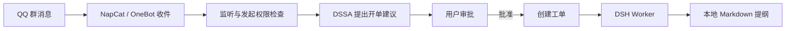

# SuperDot


*开发中的工作台界面，截图使用演示数据。*

SuperDot 把 QQ 群里交代的事整理成工单。你可以核对原消息、批准开单，再在本机查看 Agent 交付的 Markdown 提纲。

**当前进度 · Alpha**　这个仓库公开了早期 HNU Super Agent 实现，包含群消息接入、人工审批、Worker 派工和本地文件交付。首图展示的是后续 SuperDot 工作台原型。真实 QQ 账号的验证步骤见[本机验收说明](docs/verification-status.md)。

## 启动

在 macOS 上完成[首次安装](docs/setup.md)后，从仓库根目录运行下面一行。把仓库名换成当前 GitHub CLI 账号有写权限的开发仓库。

```sh
HNU_DSSA_GITHUB_REPO=你的账号/你的开发仓库 node dsh/start.mjs
```

打开「会话设置」，选择群聊、指定谁可以发起任务并开启监听。收到提纲请求后，到「工单」核对原文、批准开单，再查看 Worker 的交付文件。

## 一条群消息如何变成工单



[查看 SuperDot 总体设计图（含开发中的模块）](docs/images/architecture.svg)

## 关键设计

- **按群授权。** 每个群单独设置监听时长和发起人。开启监听时可以回看最近的消息，重复收到同一条消息不会再开一张工单。
- **开单前核对原文。** DSSA 先给出建议，用户确认后才派工。讨论里临时提到的想法可以留在收件箱。
- **在工单里审核交付。** Worker 把提纲写入本机工作目录。用户在对应会话里补充要求，按版本检查交付文件。

本地回归可运行 `node --test tests/*.test.mjs`，覆盖收件去重、权限、交付和版本审批。
