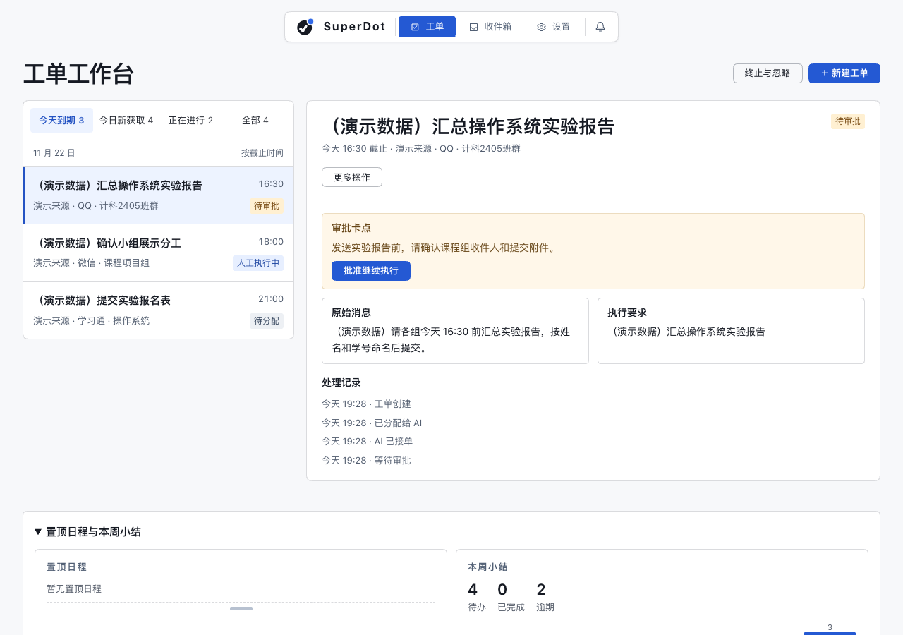
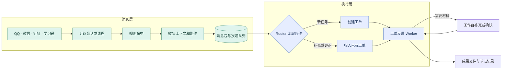
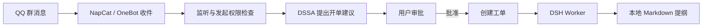

# SuperDot · 从群消息到工单交付

在群里收到一份作业通知，随后老师又更正了截止时间。SuperDot 把通知、补充说明和附件整理成消息包，由 Router 判断该新建工单，还是交给已有工单的 Worker。打开工作台，就能沿着同一条记录回看原话、补充材料和下载成果。



*工作台界面示意，使用演示数据。*

## 一条消息如何成为工单



| 在哪里看 | 能做什么 | 对应源码 |
|---|---|---|
| 设置 | 选择会话或课程，按渠道配置关键词、发送者和收集时间 | [消息规则](superdot-message-service/noticehub/rules/) |
| 收件箱 | 查看哪句话触发了组包，区分触发前的历史和后续补充 | [消息服务](superdot-message-service/) |
| 工单详情 | 阅读节点、追加要求、确认成果、打开 Worker 会话 | [执行宿主](execution-layer/exe-part/hnu-execution/) |
| DSH 会话 | 查看 Router 和 Worker 如何调用工具、读取材料及写入成果 | [角色提示词](execution-layer/exe-part/hnu-execution/prompts/) |

## 本机运行

准备 Python 3.12、Node.js 24.9 或以上版本、npm 和 DeepSeek Harness Web CLI。以下命令从仓库根目录执行。已有配置的目录会沿用原文件。

```sh
cd superdot-message-service
python3 -m venv .venv
.venv/bin/python -m pip install -r requirements.txt
test -e .env || cp .env.example .env
.venv/bin/python main.py run
```

打开启动日志中的控制台地址。先选一个渠道，保存监听范围，再检查收件箱。使用已有执行宿主时可配置 `NOTICEHUB_EXECUTION_URL`。首次启动、渠道授权方式与数据目录见[消息服务说明](superdot-message-service/README.md)。

## 如何验证

| 验证对象 | 工作目录 | 命令 |
|---|---|---|
| 消息筛选、封包和投递回执 | `superdot-message-service` | `.venv/bin/python -m unittest tests.test_message_packages tests.test_day2_delivery` |
| 工单、权限边界、Router 和 Worker 编排 | `execution-layer/exe-part/hnu-execution` | `npm ci && npm test` |

[消息层分支](https://github.com/Tivonsico/hnu-super-agent/tree/message-layer) · [执行层分支](https://github.com/Tivonsico/hnu-super-agent/tree/execution-layer) · [消息与执行接口](superdot-message-service/docs/wiki/guides/day2-integration.md)

---

<details>
<summary>早期 HNU Agent 原型与启动说明</summary>

## 启动

在 macOS 上完成[首次安装](docs/setup.md)后，从仓库根目录运行下面一行。把仓库名换成当前 GitHub CLI 账号有写权限的开发仓库。

```sh
HNU_DSSA_GITHUB_REPO=你的账号/你的开发仓库 node dsh/start.mjs
```

打开「会话设置」，选择群聊、指定谁可以发起任务并开启监听。收到提纲请求后，到「工单」核对原文、批准开单，再查看 Worker 的交付文件。

## 一条群消息如何变成工单



[查看 SuperDot 总体设计图（含开发中的模块）](docs/images/architecture.svg)

## 关键设计

- **按群授权。** 每个群单独设置监听时长和发起人。开启监听时可以回看最近的消息，重复收到同一条消息不会再开一张工单。
- **开单前核对原文。** DSSA 先给出建议，用户确认后才派工。讨论里临时提到的想法可以留在收件箱。
- **在工单里审核交付。** Worker 把提纲写入本机工作目录。用户在对应会话里补充要求，按版本检查交付文件。

本地回归可运行 `node --test tests/*.test.mjs`，覆盖收件去重、权限、交付和版本审批。

</details>
