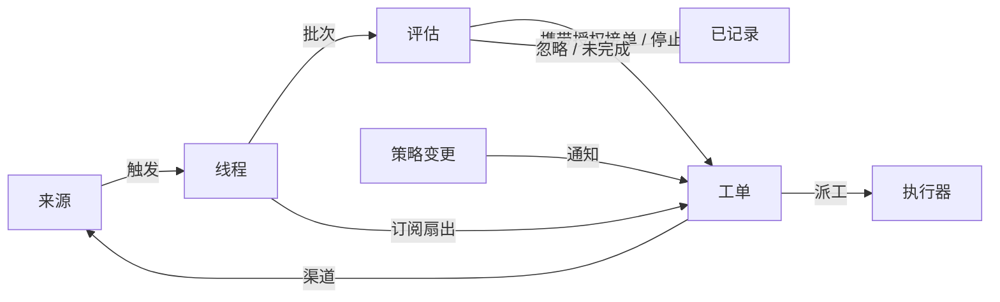

# 001 领域模型

本文为 dsh-superagent 的概念命名，并给出每个概念所维护的规则。代码、智能体调用的工具、面板以及其余文档都只使用这些术语，不使用别的叫法。遵循 [000 理念](000-理念.md)，模型只保留工作所需的概念，一项业务需求会成为其中某个概念的属性。

## 流转

工作从触发流向评估，再流向执行。来源产生触发；触发作为上下文扇出给订阅其线程的工单。以此方式到达某个工单的人的消息，就留在该工单；其余触发进入评估，由它决定是否提出新的工作。评估决定接单时，会创建一个带授权的工单。派工把工单交给执行器，结果经渠道返回来源。

## 概念

来源、线程、评估、授权与订阅构成核心领域，其余概念为它们提供支持。

| 概念 | 定义 | 所维护的规则 | 存在理由 |
| --- | --- | --- | --- |
| 来源 | 事件的流。来源种类（kind）是一份可复用的实现；来源实例是该种类的一份配置：是否运行、监听什么 | 持有自己的读取位置与机器人身份。定义什么算一个事件，包括那些只有跨时间才成立的条件。在触发进入领域之前，丢弃机器人自己发出的消息以及监听范围之外的触发。把每条触发翻译成它所属的线程，以及用于回复的渠道地址 | 重启时不能重放事件 |
| 触发 | 一条不可变的事件，附带来源自身的元数据，例如发起者 | 归属一个或多个线程。同一条触发被接单两次，只会创建一个工单 | 审计与幂等的基本单位 |
| 线程 | 按时间排序的触发；由来源定义哪些触发构成同一个线程 | 同一时刻最多运行一个评估。它可以有多个工单。它持有自己的订阅、正在运行的评估以及决定历史 | 为评估提供一致的视图与上下文 |
| 关联 | 同一条触发所归属的多个线程之间的关系 | 只补充上下文，绝不参与路由 | 让评估能够追查相关证据 |
| 渠道 | 线程的写入侧；地址由来源定义 | 一个线程可以有多个渠道；一个工单持有其中一组 | 确认、回复、拉取请求以及已解决的评审，本质上都是写入 |
| 策略 | 带版本的研判规则，以及每个来源各自的那一部分：谁可以通过该来源发起工作（以该来源自己的身份标识表示）、名单如何同步、哪些机器人可以产生候选 | 策略版本涵盖规则、接单模式与各来源部分。涉及活跃工单的变更（例如改动了它接单所依据的规则）会送达其派工，但不会撤销授权。不同来源之间的身份标识从不互相映射 | 规则一变，正在运行的评估必须丢弃 |
| 评估 | 对一批触发作出的判定，分两层：准入与研判 | 输入：触发批次、线程快照、该线程上的全部工单（含已结束的）以及当前策略。输出：一条决定。自身不持有状态 | 决定新工作是开始、继续还是停止 |
| 授权 | 一次接单所授予的内容：策略版本、范围、强度、命中的规则、发送者在该来源上的身份，以及来源接收该触发的方式 | 不可变；范围扩大意味着要新开工单。工单结束不会让它失效：只有人工停止会撤回它，不再支持它的策略会撤销它。已结束工单恢复前，需按当前策略重新校验 | 说明这项工作为何可做，以及可以做到的边界 |
| 工单 | 一项已获授权的工作 | 只有评估能创建工单。它引用自己的授权，持有渠道与输入。状态由开启 → 结束；当其线程上的人的消息将其恢复时回到开启，除非已被人工停止。它自己定义状态，而不追随执行器的状态 | 持有执行过程及其报告 |
| 派工 | 工单与某一个执行器实例之间的绑定 | 一个工单随时间可以有多个派工。其状态按待启动 → 执行中 → 已结束流转，与工单状态相互独立。只有它的最终报告，才可能从执行器一侧结束工单 | 执行器在领域之外，但「由谁执行」必须在领域之内 |
| 订阅 | 工单与线程之间的多对多关系，由线程持有 | 匹配的触发会扇出给每一个活跃的订阅工单，且不检查发送者是谁；以此方式到达工单的人的消息不经过评估。执行器为获取上下文而关注的线程，也以同样方式把消息送达其工单，但不赋予权限，也不会恢复工单。已结束的工单保留其订阅，包括那个已关闭或已合并的拉取请求对应的订阅：人的消息会在同一授权下恢复它，无需评估或决定；机器人与 CI 的消息到不了它，因为执行器恢复时会重新读取其线程。被人工停止的工单什么都收不到。只有当某条消息明确指向某个已有工单时，主 Session 才会把该线程挂上去。人可以移除某线程上的全部订阅；执行器只能移除自己工单对某个它判定为无关的线程的订阅，但工单起始所在的线程、以及来源要求它关注的线程（例如其拉取请求的线程）除外 | 后续讨论无需再次 @ 智能体，就能抵达执行器 |

「人」不是领域概念。触发按来源给出的形式携带其发起者的标识。许可名单是策略中属于某个来源的那一部分，使用该来源的身份标识。同一个人同时在多个来源上拥有账号这件事，属于智能体在需要时阅读的提示词文本。

执行器及其 Session、目录都在领域之外，通过派工与领域相连。

聚合边界：来源持有自己的读取位置；线程持有自己的订阅、正在运行的评估（该评估串行执行，并把期间到达的触发并入下一批）以及决定历史；工单持有派工、渠道与输入，并按 id 引用决定。

## 被否决的概念

| 被否决的做法 | 理由 |
| --- | --- |
| 把「主体（Principal）」或「成员关系（Membership）」建成实体，或在不同来源之间映射身份 | 人只是触发的元数据；许可名单是策略中属于来源的一部分；跨来源映射属于提示词文本 |
| 由评估给自己安排延迟触发 | 需要等待的条件就是一个普通来源，因此评估不会反向依赖来源 |
| 评估的「等待中」或「已撤销」状态 | 等待归来源负责；评估超时会重新入队其触发，或以 `unavailable` 结束 |
| 一个线程最多一个活跃工单 | 一个线程可以承载多项彼此独立的工作；研判借工单列表避免重复 |
| 「追加到工单」这样的决定 | 追加就是订阅扇出，不需要评估 |
| 对订阅做准入检查 | 订阅覆盖整个线程；授权把权限与上下文分开 |
| 让关联参与路由 | 订阅负责路由，关联只补充上下文 |
| 让工单状态追随 DSH Session | 工单可以被交接、恢复，或由多个执行器先后运行，因此它自己定义状态 |
| 由执行器声称有人要求它停止 | 只有评估能判定一次结束的强度 |
| 策略变更时取消正在运行的工单 | 直接取消会留下半途而废的工作；改为记录变更并送达 |
| 执行器 Session 失败或受阻时锁住它的全部工具 | 那会连直接在 Session 里工作的人、以及恢复后的报告一起挡掉；暂停自动输入就够了 |
| 从报告的自由文本里推断「正在等人」 | 这一分类需要结构化事实；执行器通过结构化字段提问 |

## 可复用的部分

上述概念及其规则是可复用的。来源的具体实现、策略的内容、执行器与渠道的实现，则属于某一次部署。每个来源内部保留自己的说法（例如消息、群聊、通知），并把它们翻译成触发。

| 部分 | 本仓库中的实现 |
| --- | --- |
| 来源 | 飞书：实时事件、历史补齐、对已订阅话题的轮询。GitHub：通知、已订阅的 Issue 与拉取请求、CI 变化、拉取请求被合并或关闭，以及在开关开启时，仓库中的每一条新 Issue、新拉取请求、新评论和默认分支的 CI |
| 策略 | 研判规则，以及每个来源的许可名单、同步方式、机器人名单与准入表 |
| 执行器 | 每个工单一个 DSH 执行器 Session 与一个目录，运行在由执行器与各来源注册变量的执行环境中 |
| 渠道 | 飞书话题回复、GitHub 评论与评审线程回复 |

## 术语表

本文与后续文档所用术语及其对应中文名的对照表；上文未引入的术语由后续文档解释。面板一次只显示一种语言，点开它的 (?) 按钮可看到这份双语术语表。智能体在 GitHub 和飞书上发给人看的消息使用日常语言，不用这些术语。

| 术语 | 中文 | 含义 |
| --- | --- | --- |
| Agent | 智能体 | dsh-superagent 所运行的自动化团队成员，以 GitHub 账号、飞书机器人等身份在来源上行动 |
| Main Session | 主 Session | 负责评估触发、接单与派发工单、并作出回复的 DSH Session；在代码与提示词中记作 `orchestrator` |
| Executor Session | 执行器 Session | 执行器为单个工单运行的 DSH Session；在代码与提示词中记作 `worker` |
| Source | 来源 | 事件的流：由插件提供的一种来源种类，加上一份实例配置 |
| Trigger | 触发 | 来自来源的一条不可变事件 |
| Thread | 线程 | 按时间排序的触发；评估在其中一次只运行一个的范围单位 |
| Correlation | 关联 | 共享同一条触发的线程之间的关系；只补充上下文 |
| Channel | 渠道 | 线程的写入侧 |
| Policy | 策略 | 带版本的接单规则，以及每个来源在其中所占的部分，例如谁可以在该来源提出工作请求 |
| Policy version | 策略版本 | 某一组规则、来源部分与接单模式的标识；每个授权都会记录它 |
| Eval | 评估 | 把一批触发变成一条决定的过程 |
| Gate | 准入 | 评估中确定性的第一层：谁可以发起工作，以及强度如何 |
| Assessment | 研判 | 评估过程中由模型作出的研判 |
| Decision | 决定 | 评估的结果 |
| Mandate | 授权 | 一次接单所授予的内容：强度、范围，以及它所依据的策略版本 |
| Ticket | 工单 | 一项已获授权的工作 |
| Assignment | 派工 | 工单与某一个执行器实例的绑定 |
| Subscription | 订阅 | 工单与线程之间的关系 |
| Fan-out | 扇出 | 把已订阅线程上的触发作为上下文投递给工单 |
| Executor | 执行器 | 运行派工的接口：每个工单一个执行器 Session 与一个目录 |
| Execution environment | 执行环境 | 执行器 Session 与准备命令的运行环境：由执行器与各来源注册的变量，每项含键、值与说明 |
| Report | 报告 | 派工向工单报告的状态 |
| Attention | 待人工决定 | 工单上等待人回答的问题 |
| Disposition | 去向 | 一条触发被过滤、被评估或被扇出的记录 |
| Input | 输入 | 投递给工单的上下文：扇出的触发、策略变更、恢复消息与文本 |
| Scope | 范围 | 授权所允许的工作 |
| Strength | 强度 | 授权或评估所依据理由的强弱 |

| 分组 | 取值 |
| --- | --- |
| 决定 | accept 接单 · stop 停止 · ignore 忽略 · unavailable 未完成 |
| 强度 | explicit 明确 · inferred 推断 |
| 派工 | pending 待启动 · running 执行中 · ended 已结束 |
| 报告 | progress 进展 · waiting 等待 · ready 就绪 · blocked 受阻 · failed 失败 · dropped 无需处理 |
