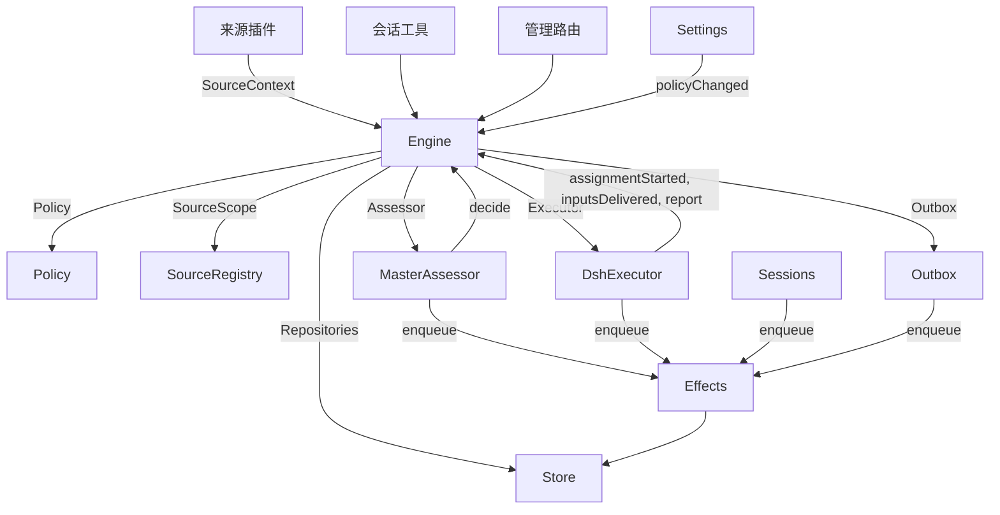

# 007 架构

本文是面向开发者的实现指南。它把 [001 领域模型](001-领域模型.md) 至 [006 部署运维](006-部署运维.md) 中的概念对应到类、接口与文件。建议先读运行时与引擎，再把模块表与测试表当作代码索引使用。

## 核心类与胶合层

核心类持有领域概念，并把外部边界收在若干小接口之后。胶合层负责把工具参数、HTTP 请求、来源载荷与 DeepSeek Harness 事件翻译成对这些类的调用，再把结果转成卡片、视图与消息。

`Runtime`（`src/app/runtime.ts`）构造整个应用、提供依赖，并负责启动与关停。`Engine` 自行构造内部各部件。执行器与研判器会回调引擎，因此 Runtime 交给它们的是 getter，而不是要求按某种循环顺序完成构造。

### 运行时

`Runtime` 是组合根，不含任何领域规则。其构造函数锁住状态目录、打开 Store 并构建各个组件。构造失败时，它会关闭 Store 并释放锁。

启动时注册管理路由并运行安装检查。安装检查完成后，安装 Session 与执行器钩子、确保主 Session 存在、启动策略同步、恢复被中断的派工，并启动轮询趟次（passes）与副作用队列（effects）。`ready` 表示启动完成。

关停时取消各个回合、等待轮询趟次、副作用队列与智能体结束、恢复进程环境、关闭 Store 并释放锁。来源插件通过窄接口 `SourceHost` 把 Runtime 注入为 `orchestrator` 服务。

| 部件 | 模块 | 职责 |
| --- | --- | --- |
| 安装检查 | `src/app/setup.ts` | 按 worker shell 同样的方式探测各 CLI，解析仓库与账号；写入并应用 worker 的环境与命令垫片；保留安装问题。Settings 通过它检查变更过的账号，并通过它重启，重启会再跑一次安装检查 |
| 轮询趟次 | `src/app/passes.ts` | 每次只跑一趟，每两秒一次、以及命令请求时立即执行：先处理到期的副作用，再执行 `Engine.evaluateDue`；来源的触发经它抵达引擎 |
| 发件箱 | `src/app/outbox.ts` | 引擎的 `Outbox` 端口，也是回执的唯一写入者：`send` 在同一个事务里保存消息回执并把它的 `reply` 副作用入队，该副作用的处理函数通过 `SourceRegistry.send` 发出消息；来源关闭期间消息等待，会话消失或不再被监听时消息被丢弃 |
| 通知 | `src/app/notices.ts` | 把领域事件与 worker 活动转成主 Session 的消息。`eventNotice` 处理领域通知；`reportRelay` 立即转发提问、把常规进展留在工单上、并转交其他报告；`followupRelay` 指明持有某条人工追问的工单。回合期间到达的转交消息，会在它的下一个步骤经 DeepSeek Harness 收件箱一并投递 |

### 引擎

`Engine`（`src/core/engine.ts`）是触发、线程、决定、工单与派工的唯一写入者。它从 `src/core/ports.ts` 接收这些端口：`Repositories`、当前策略的 getter、`SourceScope`、`Assessor`、`Executor` 与 `Outbox`。可选依赖为 `prepareTicket`、`now` 与 `emit`。

引擎的所有方法都是同步的。每条命令在一个事务内改动它所涉及的聚合。`evaluateDue` 对它改动的每个评估或工单分别使用一个事务。端口在事务内部把外部工作入队，适配器在提交之后才真正执行。非法请求抛出 `UserError`。

引擎只暴露一个入口，把工作委派给五个内部部件；每条命令的事务由它自己掌管。跨部件的命令（例如 `attach`、`evaluateDue` 与 `policyChanged`）会依次调用这些部件。

每个部件都继承 `EnginePart`（`src/core/part.ts`），由它提供配置项与共用读取。部件之间的依赖是单向的：

| 部件 | 职责 | 依赖于 |
| --- | --- | --- |
| `Intake` | 来源的一条触发：连同去向只存一次，记录到它的各线程及其关联上，扇出给订阅的工单；除非是已经到达某个工单的人的消息，否则在其主线程上排队等待评估 | Tickets |
| `Evals` | 各线程上的评估：分批、准入给出的强度／发起者／依据及其所对应的触发（`primary`）、从候选送达起算并被暂停顺延的截止时间、超时评估的重新入队、候选、重放与交回、策略变更时的重新入队，以及每次评估最终落下的决定：接单、停止、忽略或未完成 | Tickets |
| `Tickets` | 工单生命周期：由一次接单连同授权、订阅与首个派工创建；它所关注的线程及其关闭（`followsDone`）；挂载的线程与仅作上下文关注的线程；输入与备注；恢复及恢复时拒绝的消息；重试、重启、停止与结束；它取消的订阅；以及策略变更对相关工单的通知 | Replies |
| `Assignments` | 执行器及其 worker 报告的事实：派工已启动、输入已送达或送达失败、重启打断了它，以及 worker 带有面向人的问题的报告 | Tickets、Replies |
| `Replies` | 通过 `Outbox` 写入渠道：确认、答复、结果与待人工决定消息，各按允许它的规则发出 | 无 |

命令使用祈使式命名，例如 `stopTicket`；适配器上报的事实使用过去式命名，例如 `assignmentStarted`。查询 `candidate` 使用名词。

调用方只能拿到引擎中与自己角色相应的 `Pick`：`EngineForSources`、`EngineForMainSession`、`EngineForPeople`、`EngineForSettings` 或 `EngineForExecutor`。

| 角色 | 方法 | 效果 |
| --- | --- | --- |
| 来源 | `receive(trigger)` | 一条触发只存一次，并回答 `stored`、`duplicate`，或在没有任何来源接收它时回答 `filtered`；把它扇出给订阅其线程的工单，其中人的消息会立即恢复已结束的工单（除非处理已暂停）；并在其主线程上排队等待评估，除非它是已经到达某个工单的人的消息——那种消息归该工单所有 |
| 来源 | `bindThread(ticketId, thread, own)` | 让一个开启中的工单关注来源的某个线程（例如拉取请求的线程），`own` 表示该线程由工单自己开出；已关闭的线程被再次绑定时会重新开启。结束工单的是这些线程的关闭，而不是一份 `ready` 报告 |
| 来源 | `threadClosed(thread, outcome, at)` | 某个线程已关闭：每个关注它的开启中工单都会记录这次关闭，并在它对自己所关注线程的工作完成（`followsDone`）时结束——要么它开出的线程都不再开启，要么它没开出任何线程时所关注的线程全部关闭。它按这些关闭中最近一次的结果以 `merged` 或 `closed` 结束；除非关闭后恢复的工作尚未报告 `ready`，或其执行器在最近一份非 `progress` 报告之后、或上一个回合结束之后，接手了（确认或答复过）一条由它裁决的人工追问；此时一份 `dropped` 报告会按该关闭的结果结束它 |
| 主 Session | `candidate(triggerId)` | 研判器所看到的、持有某条触发的那个评估 |
| 主 Session | `candidateDelivered(evalId)` | 该评估的候选已送达主 Session：截止时间从此刻开始计算 |
| 主 Session | `decide(triggerId, outcome)` | 记录一次评估决定，或对明确请求直接记录一条决定。接单会原子地创建工单、授权、派工、订阅与确认消息。仅凭候选卡忽略推断候选时，会在所给理由之前记录 `ignoredFromCard`。只要 `followupOwners` 仍持有某条人工追问，就只允许停止 |
| 主 Session | `attach(ticketId, triggerId, note?)` | 把一条触发路由到它所指的工单，由该工单的执行器作为追问裁决，并结束持有它的评估——该评估中的其他触发等待一次新的评估；已结束工单会立即在其授权下恢复，除非处理已暂停。仍由某个执行器裁决的追问会被拒绝，路由回刚把它交回的那个工单同样被拒绝 |
| 主 Session | `requestStatus(ticketId)` | 向等待中的执行器 Session 询问其状态，并回答是否问到了 |
| 主 Session | `note(ticketId, text)` | 把来自其他工作的一条事实作为文本输入交给工单的执行器，不授予任何权限 |
| 主 Session、执行器 | `reply(request)` | 按其 purpose 所指的渠道把消息入队：`acknowledgement`、`answer`、`result` 或 `attention` |
| 人 | `stopTicket(ticketId, reason?)` | 人工停止，撤回授权 |
| 人 | `retryTicket(ticketId)` | 结束那种在 `failed` 或 `blocked` 报告后等待人工处理、或输入投递失败（`canRetry`）的工单所停滞的派工，并开启一个新派工 |
| 人 | `reevaluate(triggerId)` | 把一条已存储的触发排队，等待一次新的评估 |
| 人 | `unsubscribe(thread)` | 移除某线程上的全部订阅，原本关注它的工单不再关注；各自继续裁决在那里收到的追问 |
| 人 | `dismiss(decisionId)` | 忽略某条 `unavailable` 决定所呈现的问题，并由该决定记录下来 |
| 执行器 | `assignmentStarted(ticketId, assignmentId)` | 某个派工开始运行；其等待中的输入被发出 |
| 执行器 | `inputsDelivered(ticketId, assignmentId, inputIds)` | 输入已送达该派工的执行器 Session，在那里等待某个步骤取走 |
| 执行器 | `inputsRead(ticketId, inputIds)` | 执行器 Session 已把承载这些输入的消息纳入自身历史（一个 `user/message` Session 事件），模型由此获得它们；某个步骤虽认领了它们、但在此之前被取消或失败，则不算。只要随后有报告或回合结束，每条就算已读，重启之后同样如此，且工单结束不会放开它；在记录读取之前就投递的输入，只要其投递之后有报告或回合结束，也算已读 |
| 执行器 | `turnEnded(ticketId, assignmentId)` | 执行器 Session 的一个回合结束，报告之后也算；此时后台没有为它运行的东西，或已交接给人。某个步骤此前取走的，就算已读（`inputsRead`） |
| 执行器 | `deliveryFailed(ticketId, assignmentId, error)` | 输入投递失败；工单会一直显示该状态，直到投递成功、开启新派工或工单结束 |
| 执行器 | `report(ticketId, report)` | 记录一份报告及其中面向人的问题；`dropped` 会结束工单，`ready` 会完成不关注任何线程的工单，并让已按其线程结束方式完成所关注线程的工单结束 |
| 执行器 | `markUnrelated(ticketId, thread, reason)` | 只移除该工单对某个它判定为无关的挂载线程的订阅，并连同理由交回该线程上由该工单裁决的追问 |
| 执行器 | `followForContext(ticketId, thread)` | 让开启中的工单订阅一个相关线程作上下文：那里的消息会送达工单，但不带来追问强度，也不会恢复它 |
| 执行器 | `handback(ticketId, triggerId, reason)` | 记录该工单交回一条曾送达它的触发，理由随其候选一起携带；若确由本工单裁决，则在没有其他工单裁决它时排队等待一次新的评估，并回答是否排了队。每个工单对每条触发只交回一次，且保留自己的订阅 |
| 执行器 | `assignmentInterrupted(ticketId, assignmentId)` | 宿主停止时某个派工仍在运行：若它在工作途中被中断、或在其最近一份报告之后收到过输入，就带恢复说明重新启动，并像重试那样补上「曾投递给它、但执行器 Session 未取走」的输入；自上次报告以来已经报告过的，则保留其 Session。DshExecutor 在启动时逐一上报（`resume`），按工单从旧到新；等待中的启动也会重新入队 |
| 轮询趟次 | `evaluateDue()` | 除非处理已暂停：为排队等待触发的线程启动评估，每个线程一个，期间排队的触发合成一批；把超过截止时间的评估所持有的触发重新入队，连续两次，第三次把它记为 `unavailable`；并恢复暂停期间收到人的消息的已结束工单，前提是其授权仍成立。候选尚未送达主 Session 的评估不会过期。处理暂停期间任何评估都不会过期；恢复后，各截止时间按暂停时长顺延 |
| 设置 | `policyChanged(from, to, effects)` | 把变更以何种方式影响到每个活跃工单告知它们（`src/policy.ts` 的 `policyEffects`：接单所依据的规则变了或不再适用、请求人可能不再能发起工作、或主动工作不再被接单），并按新版本重启进行中的评估 |

引擎把分批、授权、扇出、恢复与待人工决定的生命周期规则都收在内部。若干共用谓词保证这些规则彼此一致：

- `waitsForPerson`（`src/core/model.ts`）：最近一次派工报告了 `blocked` 或 `failed`，且此后没有人的消息到达。此条件成立期间，自动输入与失败的启动都保持冻结。
- `followupOwners`：仍对自身线程上收到的人工追问负责的工单。工单可以是活跃的，也可以是未被人工停止、正等待恢复的已结束工单。交回消息即结束这份归属。
- `settled`：已有决定解决了该请求；停止、未完成、已路由与被拒停止的决定不算。
- `ticketStage`（`src/core/stage.ts`）：实现 [003 执行](003-执行.md) 中的阶段表。

工单结束时，未读的追问会退回评估，除非另一个工单仍持有它们、或另一条去向已经解决了它们。已确认、已答复与已交回的消息不在其列。对于没有确认去向的旧记录，由发件箱回执补上这一事实。最终报告也覆盖派工开始时等待中的消息，包括那条恢复工单的消息。使工单停止的那条消息不会被自动重新评估。

每次变更后，引擎发出 `src/core/ports.ts` 中 `DomainEvents` 定义的一个事件：

`trigger.received`, `eval.started`, `decision.recorded`, `ticket.created`, `ticket.resumed`, `ticket.ended`, `assignment.started`, `assignment.ended`, `thread.subscribed`, `thread.unsubscribed`, `trigger.requeued`, 或 `policy.changed`。

Runtime 把 `ticket.ended`、`trigger.requeued` 与 `thread.unsubscribed` 转成通知。送达工单的人的 `trigger.received` 会变成一条追问转交。工单以 `merged` 或 `closed` 结束时，`pullEndNotices` 用稳定 id 发出一条群聊通知。其余事件目前没有消费方。

### 模型

`src/core/model.ts` 保存领域类型，`src/core/stage.ts` 保存工单阶段。一条决定把原因记为 `reason`，即一组 `Reason`（`src/core/reasons.ts`）：每项是一个带 `values` 的 `code`，若对应批次中的某一条触发，还带 `triggerId`。

核心层的代码（例如 `timeout`、`policyChanged`、`routed` 与 `startedTicket`）属于 `REASONS`，其英文文案由智能体经 `reasonText` 读取；准入或来源范围会给出自己的代码，例如 `not_a_member`；`said` 则承载研判者或人写下的原话。面板按 `reason.<code>` 为每个代码给出文案，被来源过滤掉的触发也以同样方式记录来源的代码。

每个事实在工单里只保存一份。没有 `ended` 时工单处于开启状态；`ended` 记录结束时间、由谁结束、原因与结果。它最后说出口的内容，就是最近一次派工报告（`latestReport`）；其执行器 Session 以它命名（`src/executor/dsh.ts` 中的 `workerSessionId`）。

它的字段都有类型：`origin` 记录赋予其评估批次强度的那条准入通过的触发，以及整个批次（`triggerId`、`triggerIds`）；`execution` 记录执行器选定的内容（`name`、`directory` 与 `assignment`）；`delivery` 记录最近一次失败的输入投递（`error`、`at`），直到投递成功、开启新派工或工单结束；`follows` 记录来源要求它关注的线程，每项形如 `{thread, own, closed?}`——`own` 表示该线程由工单开出，关闭后 `closed` 带上 `at` 与 `outcome`。`follows` 只由 Tickets 写入；GitHub 来源用 `pullsOf` 与 `pullOf`（`src/sources/github-pull.ts`）读取自己的拉取请求。

承载触发的输入会记录它是否由人所写，供 `waitsForPerson` 读取。线程还在 `context` 中列出仅把它当上下文关注的订阅工单，并在 `expired` 中累计其排队触发连续超时的评估次数；一次评估记录自己的 `primary` 触发以及候选被 `delivered` 的时间。

一条触发的去向记录它经扇出或挂载到达了哪些工单、是否被某人重新入队、哪些工单连同理由于以交回，以及哪些工单的执行器确认或答复过它。

授权的 `basis`（`MandateBasis`）记录准入是如何放行其触发的。重新校验会读取接收的 `source`、`scope` 与 `row`、名单内的 `sender`、命中的 `rules`，以及 `via`：

| `via` | 准入依据 |
| --- | --- |
| `addressed` | 名单内的发送者点名了智能体 |
| `followup` | 消息到达一个已有工单的线程 |
| `admission` | 准入表中的某个单元格；`observation` 表示推断候选 |
| `bot` | 名单内的机器人产生了推断候选 |

触发与线程的 `meta` 归来源所有，核心层不解释它。

### 策略

`src/policy.ts` 定义设置模式、授权与研判规则。`settingsPolicy(settings, scope)` 每次调用都返回一份全新的、无状态的 `Policy`：

- `version`、`paused` 与 `evalTimeoutMs` 描述它的当前状态。
- `gate(trigger, thread, tickets)` 返回准入强度与依据。
- `revalidate(mandate)` 检查一个既有授权是否仍然成立。
- `admitsInferred(rules)` 只允许在 `auto` 模式、且有已启用的命中规则时主动接单。

`assessmentOutcome(assessment, settings, strength)` 把模型的研判转换成引擎的结果。它要求对每条已启用规则给出判定、方向明确、命中一条规则并有意图证据。在非 `auto` 模式下，推断型接单会变成一条「本会接单」的记录。

`policyEffects(tickets, old, now, scope)` 判断一次变更影响到哪些开启中的工单、以何种方式影响；`Engine.policyChanged` 只通知这些工单。`policyVersion` 对规则、接单模式以及各来源的策略部分（含机器人名单）做哈希。

### 存储

`Store`（`src/app/store.ts`）独占一个 SQLite 数据库。Runtime 在打开它之前先取得目录锁，避免第二个进程迁移或写入同一份状态。

它的接口按用途分组：

- **领域仓储：** `atomic`，以及 `triggers`、`threads`、`tickets`、`decisions`，各自带 `get`、`save` 与列表查询。带索引的工作集为 `threads.active()`、`tickets.open()`、`tickets.active()` 与 `read.subscribedThreads`。
- **只读查询：** `read` 通过 `threadTriggers`、`triggerStats`、`search`、`droppedReplies` 等方法服务于视图、工具与来源轮询；这些方法从不写入。
- **来源元数据：** `threads.describe` 与 `threads.patchMeta` 更新归来源所有的线程元数据。
- **设置：** `settings`、`saveSettings`、`blockRevision` 与 `settingsHistory`。设置与提示词使用带编号的 `Versions`（`src/app/versions.ts`）。
- **发件箱回执：** `replyStatus` 与 `receipts`，只由 Outbox 写入。回执操作有 `get`、`waiting`、`behind`、`add`、`settle` 与 `withdraw`。`behind` 检查同一工单发往同一会话的更早一条消息是否仍在等待、且失败次数少于三次。被撤回的消息以 `channelGone` 或 `channelIgnored` 结清。只读查询通过 `failingReplies`、`droppedReplies` 与 `droppedSince` 暴露发送失败与被丢弃的回复。
- **带类型的键值记录：** `get`、`set`、`delete` 与 `keys`，条目取自 `KV`。

`afterCommit` 只在事务提交之后执行动作，回滚后绝不执行。Runtime 按记录存储时的形状读取；schema 11 迁移会在启动时把受支持的旧记录转换过来。

### 副作用队列

`Effects`（`src/app/effects.ts`）是持久化的副作用队列。命令在事务内部调用 `enqueue(kind, key, payload)`；只有提交之后才开始执行。

每个 kind/key 组合占一行。对同一个仍在等待的 key 再次入队，会替换其载荷并让它立即到期，但不改变队列顺序。`handle(kind, run, options)` 为每种 kind 注册一个处理函数。它按从旧到新处理到期行，直到并发上限。

失败按指数退避重试。抛出 `Later` 会把工作延后而不计为失败，例如没有空闲 worker 槽位时。`start` 在安装检查之后开始处理，`drain` 在关停时停止处理但保留待处理行，`pending`／`idle` 暴露队列状态。

| 类别 | 处理方 | 动作 | 同时执行数 | 重试 |
| --- | --- | --- | --- | --- |
| `assessment` | MasterAssessor | 把某个评估的候选卡送入主 Session 的回合，随后告知引擎它已送达，由此开始该评估的截止时间 | 4，暂停时为 0 | 2 秒起翻倍至 60 秒 |
| `launch` | DshExecutor | 启动一个待启动的派工：准备命令、执行器 Session、派工消息 | 空闲 worker 槽位数，暂停时为 0 | 模型提供方或网络的一过性故障按 5 秒起翻倍至 300 秒重试三次；其他失败以及准备命令失败会使工单失败。因暂停或槽位已满而搁置的，5 秒后再试 |
| `delivery` | DshExecutor | 按顺序把工单等待中的输入交给正在运行的派工 | 4，暂停时为 0 | 2 秒起翻倍至 60 秒；等待 worker 槽位的 2 秒后再试 |
| `relay` | Sessions | 把 worker 的报告或提问、或人的追问送入主 Session 的回合 | 1，按队列顺序 | 2 秒起翻倍至 60 秒 |
| `notice` | Sessions | 把一条通知注入主 Session 而不唤醒它 | 1，按队列顺序 | 2 秒起翻倍至 60 秒 |
| `reply` | Outbox | 在该工单发往同一会话、且尚未失败三次的更早消息之后，通过来源把消息发到渠道；撤回该消息会取消发送 | 1，暂停时为 0 | 5 秒起翻倍至 300 秒；来源关闭、或排在更早消息之后时，5 秒后再试 |

每种 kind 都有一个同名的健康项。某个副作用连续失败三次后，它才报出错误；`delivery` 例外，其失败显示在对应工单上。转交保持顺序，通知同样如此；某一条失败会挡住同类里排在它后面的那些。

### 来源

来源通过 `src/sources/kind.ts` 中定义的 `SourceKind` 扩展宿主。一个 kind 声明自己的标识、标题、描述、配置 `schema` 与 `fields`、派生 `facts` 以及 `health` 条目。可选行为包括 `scope`、`channel`（`allowed`、`send`、`link`）、`threadContext`、`find`、`policy`、`environment` 与 `refreshLabels`。

`SourceRegistry`（`registry.ts`）持有已注册的 kind 与已存储的实例，并实现引擎的 `SourceScope`。注册时会在 `HealthBoard` 上认领健康项；重复认领与保留的 `sync:` 名称会被拒绝。SourceContext 只能通过其注册所认领的条目写入，因此注销之后的报告不再起作用。

注册表的配置方法包括 `kind`、`instances`、`instance`、`validate`、`validatePolicy`、`policyPart`、`channelAllowed`、`declarations`、`environments`、`find` 与 `scope`。`find` 会询问每个支持搜索的 kind。

通用代码通过注册表访问来源行为。`send(message, commands)` 调用该 kind 的渠道，返回 `sent`、`gone`，或在该 kind 未安装时返回 `waiting`。`link` 解析其渠道链接。`threadContext` 把某个 kind 的读取器与其配置配对；该 kind 没有读取器时返回空。已存储的配置不合法会禁用该实例。

插件拿到的是 `SourceHost`：注册表与 `context(kind)`。kind 自身使用的是更窄的 `SourceContext`，由 `src/app/source-context.ts` 中的 `sourceContextOf` 构造。

该上下文提供部署信息与命令、安装检查就绪状态（`ready`、`configured`、`problem`）、配置、`receive`、`atomic` 与带类型的 `state`。它还暴露线程读取与元数据写入、工单读取与绑定／关闭命令、触发读取、经 Outbox 的 `notify`，以及针对已声明健康项的 `report`。

### DshExecutor（执行器实现）

`DshExecutor`（`src/executor/dsh.ts`）为每个工单提供一个 Session 与一个目录。`start` 与 `deliver` 分别把 `launch` 与 `delivery` 副作用入队。`stop` 通过 `Store.afterCommit` 取消回合，因此一次被回滚的结束不会真的停掉 worker。

`prepare(ticket, outcome)` 为引擎的 `prepareTicket` 钩子提供内容：短名、目录与 `ticketExecution` 派工文本。`workerSessionId(ticket.id)` 推导出 Session id。

`WorkerSlots` 在启动、或唤醒空闲 worker 的投递之前预留容量。人的消息可以使用 `maxWorkers` 之外多出的一个槽位，且唤醒优先于启动。`activeCount` 为面板提供负载数据。

模型提供方与网络的一过性故障重试三次。启动沿用副作用队列的退避；失败的回合在 15、30、60 秒后收到继续执行的消息。`inputMessage` 依据工单当前状态渲染每条输入，`mandateInstructions` 为推断型工作补上命中规则所设的限制。

`install` 订阅 Session 事件，`dispose` 取消订阅。回合结束通常报告等待，但在就绪之后、或需要人工动作时除外；出错则报告失败。启动时，`resume` 通过 `assignmentInterrupted` 上报被中断的派工，并把不等待人工处理的挂起启动重新入队，按工单从旧到新。

### MasterAssessor（研判器）

`MasterAssessor`（`src/app/assessment.ts`）让主 Session 能够研判主动候选。`request` 把一次研判副作用入队；`release` 在所属评估结束时丢弃缓存状态。

它的 `context`、`read` 与 `decide` 方法分别服务于 `orchestrator_eval`、`orchestrator_eval_read` 与 `orchestrator_eval_decide`。它们经 `SourceRegistry.threadContext` 提供有界的线程上下文、仓库上下文，并接收决定提交。没有上下文读取器的 kind 只提供触发与批次。

`assessmentOutcome` 把模型的回答转换成 `Engine.decide` 所需的结果；Evals 会再按当前策略核对一次推断型接单。

### 设置

`Settings`（`src/app/settings.ts`）读写带修订号的设置块。`current` 与 `view` 负责读取，`save(block, value, revision, origin)` 校验一次保存，`pause(paused, origin)` 修改独立的 `paused` 设置。

每次保存都要声明来源：`panel`、`tool` 或 `sync`。只有 `panel` 能修改执行环境，或 `SETUP_FIELDS`（`src/deployment.ts`）中列出的字段。

策略版本变化时会计算 `policyEffects`、记录通知了哪些工单，并调用 `Engine.policyChanged`。`syncable` 与 `sync(id)` 刷新某个来源的策略部分，`refreshLabels(id)` 刷新显示名称。

### 提示词

`Prompts`（`src/app/prompts.ts`）把配置存成 `Versions`。`current`、`version` 与 `history` 负责读取，`validate`、`preview` 与 `save(value, baseRevision, source)` 负责校验和保存，`compose` 与 `skills` 组装 Session 文本。

`builtInParts` 列出可覆盖的键、角色、默认文本与必需的模板占位符。每个覆盖项保存团队 `text` 与一个 `base`：即其原始默认值对应的 `builtInBase` 键。保存时把该默认值保留在 `KV.prompts.builtIn` 下，`defaultChanged` 据此报告发生变化的默认值、能取到时的旧文本，以及被移除的部件。

校验会从已保存的覆盖项继承被省略的 base、删去已保存数据中已被移除的部件，并拒绝空白文本或其他未知键。这样保存工具就能把它读到的配置原样写回。`environmentSection` 与 `policySection` 只用自己的键，把模板值替换一次。没有覆盖的配置使用默认值。

### 会话

`Sessions`（`src/app/sessions.ts`）管理两种角色的 DeepSeek Harness Session。`ensure` 按角色对应的模型创建一个 Session；`install` 跟踪智能体事件，并为托管 Session 注册提示词、技能与工具。

`prompt` 对每个请求 id 只投递一次。`relay` 与 `notify` 把主 Session 消息入队，交由 `relay` 与 `notice` 副作用处理；内容定义在 `src/app/notices.ts`，`delivery` 检查消息是否送达。

每次模型请求都把 Session 绑定到当前的提示词修订。它用过的修订会持久化保存：`promptVersion` 标识当前生效的那一个，`mayRead` 限制 worker 可以查看哪些修订。每个智能体的注册项用一张表跟踪。

`status` 与 `promptVersion` 服务于提示词页面。保存经由 `Prompts.save`，并通知主 Session；`modelRetry` 暴露模型预算重试状态。

### 胶合层

| 胶合层 | 负责的转换 |
| --- | --- |
| `src/app/runtime.ts` | 组合根：按各部件所需的接口构建它们，注册路由与来源宿主，并启动、停止 dsh-superagent |
| `src/app/notices.ts` | 把领域事件与 worker 报告转成给主 Session 的通知与转交 |
| `src/app/tools/main.ts`, `src/app/tools/executor.ts` | 把主 Session 与执行器 Session 的工具参数转成对核心类的调用，并把结果转成卡片 |
| `src/app/http.ts`, `src/app/views/`, `src/app/api.ts` | 把 HTTP 请求转成调用、Store 读取转成面板视图；`api.ts` 为面板用到的每条路由提供类型 |
| `src/app/resources.ts`, `src/app/links.ts`, `src/app/cards.ts` | 把资源名转成读取、来源消息转成链接、记录转成供模型使用的紧凑卡片 |
| `src/sources/github*.ts`, `src/sources/feishu*.ts`, `src/sources/poll.ts` | 把 GitHub 与飞书载荷转成触发与线程事实，把消息转成 CLI 调用 |
| `src/deployment.ts`, `src/setup.ts`, `src/infra/` | 安装检查探测与问题、CLI 传输、智能体的进程环境 |

## 依赖规则

- **显式而窄的依赖。** 每个类都收到一个准确列出它所用之物的接口，多数是其他类的 `Pick` 类型：核心类用 `ExecutorHost`、`AssessorHost`、`SessionsHost`、`SettingsHost`、`SetupHost`、`PassesHost` 与 `OutboxHost`，胶合层用 `HttpHost`、`MainToolsHost`、`ExecutorToolsHost`、`ResourceHost`、`LinkHost` 与 `SourceContextDeps`；引擎则以调用方角色所对应的 `Pick` 出现。Runtime 只在这类接口之后传递自身。来源插件注入 `orchestrator` 服务，其类型把它命名为 `SourceHost`：注册表与 `context(kind)`；而该 kind 的代码只看得见自己的 `SourceContext`。
- **允许的导入方向。** `src/core` 除 Node 的哈希能力外不导入自身之外的任何东西，也不做 I/O。`src/sources` 不从 `src/app` 导入任何东西。面板从宿主侧只导入类型，以及 `src/admission.ts`、`src/limits.ts`、`src/setup.ts`、`src/navigation.ts`、`src/sources/host.ts`、`src/core/errors.ts`、`src/core/reasons.ts` 中的纯值和 `src/app/api.ts` 的筛选项列表。
- **每类状态只有一个写入者。** 每类状态只有一个写入者，其余各方要么读它，要么请那个写入者代劳。

  | 状态 | 写入者 |
  | --- | --- |
  | 触发、线程、决定、工单、派工 | 引擎 |
  | 某个来源的读取位置，以及它保存在线程上的 `meta`（`label`、`url`、`facts` 与它自己的键） | 该来源，经 `SourceContext` |
  | 设置及其历史 | Settings |
  | 提示词版本 | Prompts |
  | 副作用队列的记录行 | Effects |
  | 发件箱回执 | Outbox：引擎的消息与来源的 `notify` 都经它的 `send`，其 `reply` 副作用负责标记 |
  | 健康项 | 在 `HealthBoard`（`src/infra/health.ts`）上认领它的那个部件；HealthBoard 拒绝第二次认领：`runtime` 归 Runtime（轮询趟次经它上报）、`evals` 归每趟之后的 Runtime、`models` 归 Sessions、每种 effect kind 归 Effects、`worker` 归 DshExecutor、某个来源 kind 的条目归该 kind 来源的 SourceRegistry、`sync:<id>` 归 Settings |

  来源只能通过 `SourceContext.tickets.bindThread` 与 `threadClosed` 改动工单，而这两者都会调用引擎。
- **请求与事实。** 请求某事的方法用「祈使动词 + 对象」命名，例如 `stopTicket` 或 `bindThread`，且可能被拒绝；记录适配器已做之事的方法用过去式命名，例如 `assignmentStarted` 或 `deliveryFailed`。每个宿主按自己所需的角色类型接收引擎。
- **带类型的字段，来源数据归来源。** 代码读取工单与授权中带类型的字段。来源不在工单上存任何东西：某工单关注它的哪些线程，记在工单的 `follows` 里；它对某条触发或某个线程要保存的内容，放在它们的 `meta` 里。
- **固定拒绝。** 人或智能体可能触发的拒绝，是 `src/core/errors.ts` 中 `USER_ERRORS` 定义的 `UserError(code, values)`。管理 API 对 `missing` 代码回 404、其余回 400，面板按自身语言为每个代码给出文案。安装问题是 `SetupError` 代码（`src/setup.ts`）与固定健康文本 `HealthCode`（`src/sources/host.ts`），同样按代码给出文案。

### 与特定来源耦合的依赖

一些通用模块仍直接引用 GitHub 或飞书：

- Outbox 应用飞书群聊的字数上限。
- `src/app/links.ts` 解析飞书消息链接与 `repliedTo`；它与 Runtime 都通过 `feishuSettings` 读取设置。
- `src/app/resources.ts` 读取 `feishu/` 与 `github/` 原始记录；`src/app/cards.ts` 用 `pullOf` 生成工单卡片。
- Runtime 为以合并或关闭结束的工单发送 `pullEndNotices`。
- 执行器工具借助 Runtime 暴露的 GitHub 上下文，用 `readPull` 与 `claimPull` 绑定上报的拉取请求。
- MasterAssessor 用 `readRepositoryPath` 读取仓库文件。
- Sessions 与 Prompts 只为 GitHub 和飞书注册内置技能；迁移会转换它们的 schema 10 记录。
- 安装检查只探测 GitHub 与飞书的账号字段（`SETUP_FIELDS`）；也只有这两个来源会经 `SourceContext.problem` 收到账号类安装问题。

## 模块

| 路径 | 职责 |
| --- | --- |
| `src/index.ts` | 插件主入口：读取机器设置、启动 Runtime，并把「保存来源账号后所需的重启」交给它 |
| `src/deployment.ts` | 插件的 `Config` 与 `Machine`；`resolveDeployment` 与 `resolveFeishuBot` 从来源设置中读取仓库与账号，每次 CLI 调用都按执行器 shell 的方式运行；`SETUP_FIELDS` 列出安装检查所读取的来源字段。代码中不出现任何人名、账号或组织名 |
| `src/setup.ts` | 安装问题：`SetupError`，带代码、可修复它的位置，以及日志、主 Session 与面板共用的英文文本 |
| `src/policy.ts` | 策略：按块划分的设置模式、策略版本、准入与授权重新校验 |
| `src/admission.ts` | 准入表的取值、每个单元格的可选项与默认值，与面板共用 |
| `src/limits.ts` | 人工设置项的取值上限，由设置模式校验、面板字段提供 |
| `src/kv.ts` | `KV`：每一族 `kv` 记录的键、值类型与归属者，以及 Store 与 `SourceContext.state` 所用的 `Key` 与 `Family` 类型 |
| `src/navigation.ts` | 待宿主目录列出某个 DeepSeek Harness Session 后，从面板打开它 |
| `src/core/model.ts` | 领域类型，其中包括带类型的工单与 `MandateBasis`，以及 `threadKey`、`ticketOutcome`、`reached`、`followupOwners`、`settled`、`waitsForPerson`、`liveTicket`、`runningAssignment`、`latestAssignment` 与 `latestReport` |
| `src/core/ports.ts` | 端口：`Repositories`、`Policy`、`SourceScope`、`Assessor`、`Executor`、`Outbox`，以及领域事件 |
| `src/core/engine.ts` | 引擎（核心层入口）与角色接口 `EngineForSources`、`EngineForMainSession`、`EngineForPeople`、`EngineForSettings`、`EngineForExecutor` |
| `src/core/part.ts` | `EnginePart`（引擎各部件的基类）与 `EngineOptions` |
| `src/core/intake.ts` | `Intake`：把来源的触发送到相应工单，并在没有人的消息到达工单时送交评估 |
| `src/core/evals.ts` | `Evals`：各线程上的评估及其决定 |
| `src/core/tickets.ts` | `Tickets`：工单生命周期、工单关注的线程、订阅与输入 |
| `src/core/assignments.ts` | `Assignments`：执行器上报的事实与其 worker 的报告 |
| `src/core/replies.ts` | `Replies`：引擎对渠道的写入 |
| `src/core/stage.ts` | `ticketStage` 与 `canRetry`：[003 执行](003-执行.md) 的工单阶段 |
| `src/core/errors.ts` | `UserError` 与 `USER_ERRORS` |
| `src/core/reasons.ts` | `Reason`、`REASONS` 与 `reasonText`：按代码说明核心层为何记录一条决定或搁置一条触发 |
| `src/core/ids.ts` | `key`：由输入推导出的 id，相同输入得到相同结果 |
| `src/core/memory.ts` | `MemoryRepositories`：把 Store 的仓储放在内存中，沿用 Store 的顺序与嵌套回滚，供领域测试使用 |
| `src/core/index.ts` | 核心层的导出 |
| `src/app/runtime.ts` | Runtime（组合根）及其启停 |
| `src/app/setup.ts` | 安装检查，以及 `setupChanged`（一次保存是否改动了安装检查所读的字段） |
| `src/app/passes.ts` | 轮询趟次（Passes）及其调度 |
| `src/app/outbox.ts` | Outbox：引擎的 `Outbox` 端口、回执，以及发送消息的 `reply` 副作用 |
| `src/app/notices.ts` | 主 Session 的通知与转交：`eventNotice`、`reportRelay`、`resultRelay` 与 `followupRelay` |
| `src/app/store.ts` | Store，以及发件箱的一条消息 `Receipt` |
| `src/app/store-read.ts` | `storeReads`：Store 供视图、工具与来源轮询使用的只读查询，从不写入 |
| `src/app/migration.ts` | schema 11 迁移：一步从 schema 10 把每条已存记录写成当前形状 |
| `src/app/effects.ts` | 副作用队列 Effects |
| `src/app/versions.ts` | `Versions`：以带编号快照形式保存的记录，另有指向当前版本的指针，供设置与提示词使用 |
| `src/app/cache.ts` | `TextCache`：在内存里按大小上限保存文本，优先淘汰最久未用的 |
| `src/app/settings.ts` | 设置 |
| `src/app/settings-history.ts` | `policyHistory`：每个已保存的设置修订，及其相对上一版改了什么 |
| `src/app/prompts.ts` | 提示词 `Prompts`、`builtInParts`（团队可覆盖的内置部件）与 `promptParts`（某角色提示词小节的顺序） |
| `src/app/context.ts` | 从 `prompts/` 读取的内置提示词文本，以及 Session 读取的记录条目 |
| `src/app/skill-files.ts` | 打包文本：`promptFile`（把文件中每句一行的内容拼成段落）与随包附带的技能 |
| `src/app/sessions.ts` | 会话 Sessions |
| `src/app/delivery.ts` | `AgentDelivery`：按请求 id 向 DeepSeek Harness 智能体投递一次消息，Session 恢复后同样成立 |
| `src/app/retry-health.ts` | `RetryHealth`：哪些 Session 正在等待模型预算重试，供 `models` 健康项使用 |
| `src/app/role-models.ts` | 解析评估与执行器模型，并在新建 Session 时按其角色设定模型 |
| `src/app/assessment.ts` | MasterAssessor、研判模式，以及 `orchestrator_eval` 作答所用的窗口 |
| `src/app/execution-environment.ts` | 执行环境：其变量、某工单的取值、目录根路径与提示词小节各行，由 `src/app/prompts.ts` 填入模板 |
| `src/app/source-context.ts` | `sourceContextOf`：为每个来源 kind 构造 `SourceContext` |
| `src/app/links.ts` | `sourceLink`（触发消息所在页面）与 `candidateCard` |
| `src/app/cards.ts` | 供模型使用的触发、工单、线程、决定的紧凑卡片，工单卡片状态的闭集 `TICKET_STATES`，以及 `textPage` |
| `src/app/resources.ts` | `RESOURCES` 与 `readResource`：`orchestrator_read` 按角色可读取的内容 |
| `src/app/tools/tool.ts` | `Tool` 类型、`readTool`（两种角色的 `orchestrator_read`）与 `AcknowledgementSchema` |
| `src/app/tools/main.ts` | 主 Session 的工具 |
| `src/app/tools/executor.ts` | 执行器 Session 的工具 |
| `src/app/http.ts` | `/orchestrator/api` 路由：同源校验、请求体限制，以及每类失败对应的状态码 |
| `src/app/api.ts` | `Api`：每条路由的参数、查询、请求体与响应，以及列表筛选项；它只导入类型，因此可被面板打包 |
| `src/app/views/text.ts` | 视图文本的两种形式：单行纯文本的 `preview`、不含 HTML 的 `markdown`；以及 `plain` 与 `readable` |
| `src/app/views/records.ts` | 各视图共用的行：触发、工单、线程、决定与渠道链接，以及 `ownersOf`（一次请求所读到的追问归属者） |
| `src/app/views/tickets.ts` | 按阶段划分的工单列表、工单页面、授权依据事实与执行器负载 |
| `src/app/views/threads.ts` | 线程列表、线程时间线、搜索与决定列表 |
| `src/app/views/sources.ts` | 来源状态：每个来源实例的状态、最近一天的计数，以及当天被过滤与被丢弃的内容 |
| `src/app/views/settings.ts` | 设置页视图：每个配置块及其修订号、每个来源的设置及其 kind 表单，以及执行环境 |
| `src/app/views/overview.ts` | 总览：需要人工处理的工单、问题、最近一天的流转与执行器负载 |
| `src/executor/dsh.ts` | DshExecutor、`WorkerSlots`、`ticketExecution`、`inputMessage` 与 `mandateInstructions` |
| `src/executor/background.ts` | DeepSeek Harness 中 worker 的后台工作：其 Session 拥有的 shell 作业（`ctx.jobs`）与子智能体（`ctx.subagents`）；`runningJobs`、`untilQuiet`、`killJobs`、`collectJobs`、`stopSubagents`、`stopBackground`、`until`，以及 `cancelled`（因停止子智能体而回合被取消的 worker） |
| `src/infra/commands.ts` | `Commands`（CLI 传输层）：`run`；限于所配置仓库并经过校验的 `api` 与 `pages`；以机器人身份运行的 `lark`；`git`。`CliError` 携带命令输出所报告的代码（例如 GitHub HTTP 状态），且没有任何输出的命令按其结束方式报错，绝不带上参数；`validItems` 跳过并统计列表中格式不合法的条目 |
| `src/infra/environment.ts` | 智能体的进程环境：命令垫片、git 配置与凭据助手、`runAsWorker`，以及环境与工单目录的检查 |
| `src/infra/paths.ts` | 包的根目录，即打包文件所在位置 |
| `src/infra/text.ts` | 词数统计与群聊消息上限、`fill` 与 `sameName` |
| `src/infra/health.ts` | `HealthBoard`、每个部件的健康项，各由唯一写入者认领 |
| `src/sources/kind.ts` | `SourceKind` 协议 |
| `src/sources/registry.ts` | `SourceRegistry` |
| `src/sources/host.ts` | `SourceHost`、`SourceContext`、`Health`、`health` 与固定健康文本 |
| `src/sources/poll.ts` | GitHub 与飞书轮询共用的部分：`POLL_HORIZON_MS`、`polled`、`cursorAt`，以及把失败以 `pollError` 留在线程上的 `pollThreads` |
| `src/sources/github.ts` | GitHub kind 与插件入口，以 `./github-watch` 导出：一轮通知轮询、活跃工单的拉取请求及其 CI、已订阅线程 |
| `src/sources/github-trigger.ts` | 把 GitHub 评论、评审、Issue 正文与 CI 变化转成触发，以及 GitHub 地址 |
| `src/sources/github-pull.ts` | 拉取请求规则：工单关注哪些拉取请求（`claimPull`、`observePull`）、向引擎上报的关闭，以及 `pullEndNotices`（工单以合并或关闭结束时的群聊通知） |
| `src/sources/github-channel.ts` | GitHub 渠道：评论与评审线程回复，返回 `sent` 或 `gone` |
| `src/sources/github-read.ts` | CI 快照、仓库读取、`github/` 资源，以及按页给出 Issue 或拉取请求会话的 `githubThreadContext` |
| `src/sources/feishu.ts` | 飞书 kind 与插件入口，以 `./feishu-watch` 导出 |
| `src/sources/feishu-trigger.ts` | 按同一套规则把飞书的实时事件、历史分页与话题分页消息转成触发 |
| `src/sources/feishu-loops.ts` | 飞书的各个循环：事件消费、历史补齐、群名称，以及对已订阅话题的轮询 |
| `src/sources/feishu-channel.ts` | 飞书渠道：话题回复，返回 `sent` 或 `gone` |
| `src/sources/feishu-read.ts` | 对触发消息的 `feishu/` 读取：其根消息、父消息与话题，以及把连同图片一起交给研判的 `feishuThreadContext` |
| `src/sources/admission-context.ts` | 研判起步所用的有界窗口：经其 kind 读取的触发所在线程的前几页，以及该触发前后的消息 |
| `src/sources/feishu-image.ts` | 把飞书消息中的图片读成研判 Session 的附件 |
| `src/client/index.tsx` | 客户端插件入口：侧边栏入口、主面板，以及 DeepSeek Harness 插件管理器中的页面 |
| `src/client/app.tsx` | 面板：页头、搜索、术语表、标签页与当前路由的页面 |
| `src/client/provider.tsx` | 每个页面从宿主读取的内容：文案、调用、导航、通知、状态轮询，以及 `restart`（在 dsh-superagent 重启期间快速读取状态） |
| `src/client/api.ts` | 管理 API 的调用与轮询，类型来自 `src/app/api.ts`，以及评估状态的决定筛选项 |
| `src/client/route.ts` | 标签页、设置分组、`parseRoute` 所读的带类型路由，以及记住上次打开设置分组的路由记忆 |
| `src/client/overview.tsx` | 总览 |
| `src/client/source.tsx`, `trigger.tsx`, `eval.tsx`, `execution.tsx` | 每个阶段一个文件：其状态，以及有设置时的设置内容 |
| `src/client/thread.tsx`, `ticket.tsx` | 记录页：带时间线的线程，以及带授权、输入与派工的工单 |
| `src/client/settings.tsx` | 设置标签页：分组导航与当前显示的分组 |
| `src/client/settings-kit.tsx` | 设置区块的构件：各阶段分组共用的设置、`useBlockDraft`、各类字段（含来源 kind 的字段）与保存历史 |
| `src/client/prompts.tsx` | 提示词设置：页面持有它读到的视图，编辑器持有草稿；编辑、完整提示词与历史三个标签页据此渲染；内置部件的编辑器展示变化过的默认值，并保留或移除覆盖 |
| `src/client/prompt-config.ts` | 按小节划分的提示词配置、团队小节、技能名、内置部件（`part/<key>`，带 `withOverride`）、提示词视图给出的部件标题，以及完整提示词的行级差异，均为纯函数 |
| `src/client/deployment.tsx` | 部署设置，同时也显示在 DeepSeek Harness 插件管理器中 |
| `src/client/draft.tsx` | 设置草稿：`draftReducer`、草稿状态、与更新后的已保存修订合并、`saveBarText`（保存栏文案）以及保存栏本身 |
| `src/client/controls.tsx` | DeepSeek Harness 控件的本地副本，沿用其标记结构、键盘行为与设计令牌，因为本扩展包不导入 `@deepseek-ai/dsh-client-ui-primitives`；它们不读取上下文 |
| `src/client/widgets.tsx` | 各页面共用的小组件，读取面板上下文：区块、页头、加载状态、时间、链接、需确认的操作、安装检查与 Markdown |
| `src/client/rows.tsx` | 各页面共用的行：工单、线程、决定的行，线程的标记，以及连续自动化消息的折叠 |
| `src/client/markdown.ts` | 报告与提问所用的 Markdown 子集，以及消息中的裸地址，按块级与行内两部分处理 |
| `src/client/text.ts` | 按键取用的文案，以及领域取值、理由、发送者与时间的措辞 |
| `src/client/marks.ts` | 视图所分类状态的标记：工单或线程的阶段、来源状态、决定结果，各含圆点、图标、色调与标签 |
| `src/client/locales.ts` | 两种语言的全部文案，以及 [001 领域模型](001-领域模型.md) 的术语表 |
| `src/client/client.css`, `css.d.ts` | 面板样式表，以文本形式加载 |

`src/sources/github.ts` 与 `src/sources/feishu.ts` 同时也是两个来源插件的入口，由 `tsdown.config.ts` 构建，并在 `package.json` 中以 `./github-watch`、`./feishu-watch` 导出。扩展包的 `cordis.patch.yml` 插入这三个插件，其中飞书默认禁用。

## 测试

| 测试 | 覆盖范围 |
| --- | --- |
| `tests/core-engine.spec.ts` | 内存仓储上的领域规则：接收、评估、扇出、恢复与停止、被中断的派工、暂停、策略变更、报告与结果、挂载、回复、投递失败与被忽略的问题 |
| `tests/stage.spec.ts` | 逐行核对工单阶段 |
| `tests/policy.spec.ts` | 来源范围、准入、准入表、授权重新校验、策略版本、设置迁移与研判结果 |
| `tests/registry.spec.ts` | `SourceRegistry`：实例、校验、策略部分、渠道与线程上下文 |
| `tests/sources.spec.ts` | 在 `SourceContext` 上的飞书与 GitHub 来源：翻译、轮询与读取位置、拉取请求规则、健康状态 |
| `tests/commands.spec.ts` | 以部署账号身份发起 CLI 调用、渠道的应答，以及限定仓库范围的 GitHub 调用 |
| `tests/feishu-read.spec.ts`, `tests/github-read.spec.ts` | 飞书与 GitHub 的读取 |
| `tests/admission-context.spec.ts`, `tests/feishu-image.spec.ts` | 研判所用的线程窗口，以及飞书图片读取 |
| `tests/assessment.spec.ts` | MasterAssessor 为每个评估保留什么、何时释放 |
| `tests/background.spec.ts` | 等待 worker 的 shell 作业与子智能体：唤醒它的那次结束，以及宿主停止 |
| `tests/bundle-patch.spec.ts` | 按 DeepSeek Harness 的读法解读扩展包的补丁，以及它定义的执行器 Session 智能体预设 |
| `tests/effects.spec.ts` | 副作用队列：合并、上限、带退避的重试、健康项与关停 |
| `tests/passes.spec.ts` | 轮询趟次：一次只跑一趟、趟次中请求的那些在它之后一并执行、以及失败趟次上报的运行时健康状态 |
| `tests/outbox.spec.ts` | 运行中的 Runtime 上的 Outbox：处理暂停或来源未安装时消息等待 |
| `tests/cache.spec.ts` | `TextCache` |
| `tests/queue.spec.ts` | Runtime 经副作用队列完成的工作，以及早期版本存过的内容 |
| `tests/followups.spec.ts` | 工单线程上人的追问：给主 Session 的通知、作用于它的工具、一连串追问的开销；worker 的交回与上下文关注，以及主 Session 的备注 |
| `tests/health.spec.ts` | 每个部件一个健康项，各由自己下一次成功清除 |
| `tests/delivery.spec.ts` | `AgentDelivery` |
| `tests/retry-health.spec.ts`, `tests/role-models.spec.ts` | 模型预算重试，以及两种角色的模型 |
| `tests/runtime.spec.ts` | 在模拟的 DeepSeek Harness 宿主上，经工具与 HTTP 跑通整个应用 |
| `tests/tools.spec.ts` | Session 的工具：两种角色各自能用 `orchestrator_read` 读什么，以及其他主 Session 工具的形状与校验 |
| `tests/runtime-concurrency.spec.ts` | 相互重叠的工作：趟次期间到达的触发、投递与启动期间发生变化的工单 |
| `tests/http.spec.ts` | 同源与环回校验、各类失败的状态码、请求体上限、路径参数与查询 |
| `tests/settings.spec.ts` | 与模型或账号检查竞态的设置保存、被保存抢先的策略同步，以及暂停、同步与配置块的拒绝行为 |
| `tests/views.spec.ts` | 管理视图从 Store 推导出的内容，例如被丢弃消息所属的线程 |
| `tests/timeline.spec.ts` | 线程的分页，以及按时间再按 id 排列的触发邻近项；每条已接收触发的时间统一成一种形式 |
| `tests/migration.spec.ts` | schema 11 迁移：每条已存记录写成当前形状，并拒绝更旧的 schema |
| `tests/store.spec.ts` | 仓储及其工作集，SQLite 与内存两种实现；kv 区域，`KV` 的每个键只在 `src/kv.ts` 与迁移中出现；设置历史与查询 |
| `tests/prompts.spec.ts` | 提示词的校验、组装与版本 |
| `tests/cards.spec.ts` | 内置文本必须逐文件写明的规则 |
| `tests/model-surface.spec.ts` | 模型可读的一切：工具、提示词、技能与输入，对照工具模式、执行环境与术语表核验，并按角色设定大小预算 |
| `tests/deployment.spec.ts`, `tests/environment.spec.ts`, `tests/index.spec.ts` | 插件配置与安装检查、智能体的进程环境、插件入口 |
| `tests/service-script.spec.ts` | 用假的 `ps`、`tmux` 与 `dsh` 检验 `scripts/dsh-superagent` |
| `tests/client.spec.tsx`, `tests/navigation.spec.ts`, `tests/controls.spec.tsx` | 客户端插件的注册与轮询、Session 导航与路由记忆、本地控件，以及无循环的面板导入 |
| `tests/panel-overview.spec.tsx`, `panel-source.spec.tsx`, `panel-trigger.spec.tsx`, `panel-eval.spec.tsx`, `panel-execution.spec.tsx` | 面板的每个页面，对着按路由应答的假管理 API |
| `tests/panel-settings.spec.tsx`, `panel-prompts.spec.tsx`, `panel-deployment.spec.tsx`, `panel-panel.spec.tsx` | 设置分组、草稿与历史、提示词、部署页，以及面板的搜索、术语表与路由记忆 |
| `tests/draft.spec.ts`, `tests/prompt-config.spec.ts`, `tests/markdown.spec.ts`, `tests/marks.spec.ts` | 草稿状态、合并与保存栏文案；按小节划分的提示词配置与行级差异；Markdown 子集及其链接；视图所分类每种状态的标记 |
| `tests/locales.spec.ts`, `tests/styles.spec.ts` | 两种语言的文案、样式表 |
| `tests/class-docs.spec.ts` | `src` 中每个类前面都有 JSDoc 块 |
| `tests/docs.spec.ts` | 编号文档只链接到更早的文档、每个本地链接都能解析、没有任何文档残留合并冲突标记，且本文的表格列出了每个模块与每个测试 |

`tests/fixtures/` 存放多个测试共用的东西：`host.ts`（模拟的 DeepSeek Harness 宿主）、`panel-server.ts` 与 `panel.tsx`（假管理 API 与包住某个页面的面板）、`deployment.ts`（一份已解析的部署）、`git.ts`（测试所启动的每个 git 的环境，其中不点名任何仓库）以及 `async.ts`。

## 持久化

一个 SQLite 文件 `<stateDir>/orchestrator.sqlite`，只有 Store 会打开它。

| 表 | 存放内容 | 写入者 |
| --- | --- | --- |
| `trigger` | 每条触发，其时间 `at` 统一采用 `Date#toISOString` 给出的形式，在引擎接收它时设定，因此时间可按文本比较 | 引擎 |
| `disposition` | 每条触发的去向：带来源原因码的 `filtered`、它所属的评估与决定、经扇出或挂载到达的工单、是否被重新入队、连同理由于以交回的工单，以及其执行器确认或答复过它的工单 | 引擎 |
| `trigger_thread` | 每条触发位于哪些线程上，附其时间以及是否由人所写，因此读取某线程的触发无需扫描全部触发，按时间再按 id 排序：线程时间线的一页从 `<at>|<id>` 游标继续，且时间相同的触发不会被跳过 | Store，随每条触发一起写入 |
| `thread` | 线程：订阅、仅把它当上下文关注的工单、排队的触发、进行中的评估、连续超时次数与 `meta`；生成列 `active`（有触发排队或有评估运行时置位）与 `subscribed`（有工单订阅它时记录其来源） | 引擎；来源写入 `meta` |
| `ticket` | 工单，连同授权、来源、执行信息、派工、渠道、输入与其关注的线程；生成列 `open`（尚未结束时置位）与 `active`（输入未投递、或最近一次派工待启动／执行中时置位） | 引擎 |
| `decision` | 决定，按线程组织 | 引擎 |
| `effect` | 副作用队列：按 kind 与 key 记录载荷、顺序、失败尝试及最后错误、以及到期时间 | Effects；schema 11 迁移会把早期版本为主 Session 留存的内容入队 |
| `outbox` | 发件箱中每条发往渠道的消息回执：按 id 记录，含所属工单与 `status`（`pending`、`sent` 或 `dropped`），以保证同一 id 绝不入队两次；被丢弃的消息以生成列 `dropped` 记录时间与原因码。等待中的消息对应一个 `reply` 副作用，其中保存其尝试次数 | Outbox |
| `kv` | 其余所有记录，按键组织 | 点名该键的那个部件 |

生成列由其所在行的 JSON 计算得出，不在其集合内时为空；每个生成列都在自己的集合上建了索引，因此一趟轮询只读取活跃的工作。早于该列存在的数据库，会在 Store 打开它时补上。

`KV`（`src/kv.ts`）定义每条键值记录的归属者、键与类型。所有读写方都使用这些条目；只有迁移代码会点名旧键。

| 记录 | 键或内容 |
| --- | --- |
| Schema | 当前 schema 版本 |
| 设置版本 | `settings-revision`、`settings-version:<n>`、`settings-block-revision:<block>`；快照包含来源、策略版本与受影响的工单 |
| 提示词版本 | `prompt-revision`、`prompt-version:<n>` |
| 主 Session | `master-id` |
| Session 提示词历史 | `session-prompts:<session id>` |
| 来源状态 | 读取位置（例如 `github-cursor:<number>`）、拉取请求 CI 指纹、已见过的飞书话题消息；键以 kind 或 `thread-` 加线程键开头 |
| 显示名称 | `source-labels:<source id>` |

忽略状态保存在对应的决定上。输入文本在读取时由工单渲染，因此两者都不需要单独的键值记录。

读取缓存使用有上限的内存 `TextCache`，重启即丢失。Session 在分页浏览来源原始记录或提示词预览时，重启后必须从 offset 0 重新读取。接收之后才解析出的飞书链接也以同样方式缓存；基于链接的搜索，只有该链接在本次进程生命周期内被读过之后才能找到。

目前还没有任何清理旧记录的机制，所以下列内容会无限增长：`trigger`、`disposition` 与 `decision` 行；已结束的工单及其线程；发件箱回执；以及 `kv` 中每一个已保存的设置修订与提示词版本、每个 Session 用过的提示词修订、来源按线程以及按 Issue／拉取请求保存的记录。

`SCHEMA_VERSION` 只增不减。更新版本的数据库会拒绝启动；`src/app/migration.ts` 在启动时把预发布版 schema 10 的数据库升级一次，更旧的则拒绝。

## 面向模型的接口

### 主 Session 工具

主 Session 有 14 个应用工具：

| 用途 | 工具 |
| --- | --- |
| 读取与路由 | `orchestrator_read`, `orchestrator_route` |
| 管理工单 | `orchestrator_ticket_retry`, `orchestrator_ticket_request_status`, `orchestrator_ticket_note` |
| 重新评估 | `orchestrator_trigger_requeue` |
| 研判主动工作 | `orchestrator_eval`, `orchestrator_eval_read`, `orchestrator_eval_decide` |
| 沟通与取消订阅 | `orchestrator_reply`, `orchestrator_thread_unsubscribe` |
| 配置 | `orchestrator_settings_save`, `orchestrator_policy_sync`, `orchestrator_prompts_save` |

`orchestrator_route` 按顺序接受 1–20 条决定。每条接单、挂载、停止或忽略都作为一条独立的引擎命令执行。它也允许仅凭候选卡直接忽略推断候选。`orchestrator_ticket_note` 发送的是作为上下文的事实，不是权限。

设置保存可选 `policy`、`eval`、`executor`、`pause` 或 `source`；最后一项还要给出来源 id。提示词保存带 `preview: true` 时只组装文本而不保存。

主 Session 还拥有 DeepSeek Harness 的 `skill`、`bash`、`read`、`read_image`、`job_output`、`job_list` 与 `job_kill`。不读代码是一条提示词规则，而不是工具层面的限制。

### 预设与等待上限

新建的主 Session 使用 `dsh-superagent-router`（`ROUTER_PRESET`）。shell 命令与作业等待在 5 秒后返回。若 Web 界面在首个回合之前选了别的预设，`Sessions` 会把它恢复回来；worker 则恢复为 `WORKER_PRESET`。

`src/app/sessions.ts` 中的 `noWait` 防护会拒绝主 Session 里在命令位置调用 `sleep` 的 shell 命令、超过 30 秒的 shell `timeoutMs`，以及超过 5 秒的 `job_output` 等待。报告与作业结果会自动到达，等待只会拖慢新候选的进入。

已经运行在 `standard` 上的主 Session，还需要为前台命令与作业等待显式设定超时；否则该预设的默认值会分别把步骤卡住 60 秒和 30 秒。宿主通过 `presetForSession` 判定当前预设，取不到时回退到 Session 的投影或头部信息，仍读不到就假定为 `standard`。

### 执行器工具

每个执行器有六个应用工具：

| 工具 | 用途 |
| --- | --- |
| `orchestrator_read` | 读取自己工单可用的资源 |
| `orchestrator_ack` | 确认一条请求 |
| `orchestrator_report` | 报告进展或结果，并按拉取请求规则绑定拉取请求 |
| `orchestrator_thread_unrelated` | 丢弃一个无关的挂载线程，交回其上归自己所有的追问，并告知主 Session 原因 |
| `orchestrator_thread_follow` | 订阅一个相关线程作上下文，并告知主 Session |
| `orchestrator_trigger_handback` | 把一条消息交回一次，理由随其候选携带 |

若另一个工单仍持有该消息、或本工单从未持有过它，交回会返回 `queued: false`。例如机器人消息本就独立地送交了评估。

worker 预设定义在 `cordis.patch.yml` 中，通过 `WORKER_PRESET` 选用。`src/app/sessions.ts` 中的 `WORK_TOOLS` 保留可用的文件、搜索、shell、作业、网页、技能、待办与子智能体工具。worker 拿不到向人提问或展示、修改配置档、在 worker 槽位之外排定工作、启动其他 Session 或给它们发消息、编辑外部文档的工具。工单结束后，工具调用一律被拒绝。

### 结果结构与研判上下文

路由结果采用 `{decision?, reason, ticket?}`。`orchestrator_route` 返回 `{results}`，保持条目顺序，并为每项补上 `trigger_id` 与 `kind`。非法或被拒的条目返回 `refused` 与理由，不会中断整批。

设置与提示词的保存返回已保存的配置。策略同步返回该来源、许可名单大小，以及 `added` 与 `removed` 的名称。

`orchestrator_eval` 返回的是上下文而不是指令。研判指令位于 `runtime/admission`（`prompts/admission.md`），规则位于 `runtime/policy`。其上下文包括：

- 触发文本，最多 4,000 字符，附图片 id 与同批次的其他触发。
- 最多八个 `related_tickets`，开启中的排在前面，以及 `tickets_total`。
- 该评估的 `policy_version`。
- 线程窗口：最前面的五条消息，以及该触发前后各五条。消息采用 `{id, from, at, text}`，通常限 400 字符，紧邻前后各一条放宽到 1,200 字符。被截断的消息带 `chars`；图片引用使用 `images`。
- 其他已加载消息以 50 字符的 `{id, from, preview}` 摘要形式出现；`orchestrator_eval_read` 按 id 展开它们。

工单卡片使用 `src/app/cards.ts` 中的闭集 `TICKET_STATES`：要么是 `person/review`、`working/queued` 这样的开启阶段，要么是结束结果。确认消息无论经接单、研判还是 `orchestrator_ack` 提交，都限 100 词。

### 读取资源

`src/app/resources.ts` 中的 `RESOURCES` 定义各类资源，并生成工具的 `resource` 描述。

| 资源 | 内容 |
| --- | --- |
| `tickets`, `triggers`, `threads`, `decisions` | 分页列表，形如 `{items, next_offset}`；活动列表把最新的排在最前 |
| `decision/<id>` | 单条决定 |
| `thread/<key>` | 标签、工单、近期决定与一页触发 |
| `trigger/<id>` | 消息文本、所回复的触发与邻近消息，不含 CI 运行 |
| `ticket/<id>` | 相关 id、来源批次触发、线程，以及派工与输入的首页 |
| 工单子资源 | `/assignments`, `/inputs`, `/assignment`, `/result`, `/report/<assignment id>`, `/transcript`, `/message/<n>`, `/input/<id>` |
| `settings`, `settings/<block>` | 修订号与摘要，或一份可直接保存的完整配置块 |
| `prompts`, `prompts/<revision>`, `prompts/current`, `prompts/defaults`, `prompt-preview/<id>` | 提示词配置与组装后的文本 |
| `models`, `models/<provider>` | 可用模型 |
| `feishu/<trigger id>/…`, `github/…` | 来源原始记录，见各来源技能中的说明 |

工单线程中，仅作上下文关注的标为 `context`，由来源绑定的标为 `bound`。派工分页把最新的排在最前，并附报告预览。列表用 `next_offset` 继续。`/input/<id>` 接受输入的名称或 id。`settings` 对较小的配置块给出全文，对策略与来源块给出摘要。

来源资源还包括消息邻域、`github/pulls/<n>/thread/<comment id>` 与 `github/commits/<sha>/checks`。

原始记录中的消息统一读成一种紧凑形状 `{id, from, at, text, reply_to?, path?, line?, url?}`，而不是 GitHub 或飞书各自的记录形式。

执行器 Session 只能读到自己的工单、其线程、曾送达它或由其请求所含的触发、自己工作过的提示词版本与原始记录；它的分页会略去无权读取对象的 id、决定以及其他工单。

页面上出现的每个 id 都能经上述某一项读到，Session 因此可以从一个对象走到下一个；没有谁会按哈希去读的东西（例如评估 id 或策略版本）不会出现在页面上。

文本页默认 4,000 个 UTF-16 码元、最多 8,000；列表默认 20 项、最多 50 项。

早期版本的 `event/`、`task/` 与 `observation/` 名称仍可解析。

### 送达 Session 的消息

下列消息会被送入主 Session 的回合：

| 消息 | 内容 |
| --- | --- |
| Candidate | 批次触发卡、线程、`related_tickets`、`tickets_total`、`delivered_to`、由 Issue／PR 链接引用的工单、`handed_back` 理由与下一步动作 |
| `follow_up` | 一条消息（按执行器所见的形式）、`replies_to`、接收它的工单，以及「追问由执行器裁决、主 Session 只能停止工作」的提醒 |
| `worker_report` | 工单卡片、最初的触发、状态与最多 600 字符的摘要；被截断时附 `chars` 与读取指针 |
| `worker_attention` | 携带该问题的工单卡片 |

其他通知以不唤醒主 Session 的方式注入：`ticket_ended`、`settings_saved`、提示词保存、触发重新入队、订阅取消与上下文关注。设置类通知会点名配置块、变更路径以及 `read: settings/<block>`。对于主 Session 自己执行的保存、重新入队、取消订阅或挂载，不会再收到一条多余的通知。

worker 以内联形式收到派工与输入。第一条消息包含标题、最多 1,500 字符的派工文本与来源触发卡。输入携带一张最多 600 字符、带 `replies_to` 的触发卡，或纯输入文本。只有被截断的内容才会出现读取指针。

### 仅限面板的操作

下列操作没有对应工具：忽略一条 `unavailable` 决定、重跑安装检查、刷新来源显示名称、把归执行器所有的人工追问送交评估。最后一项会被 `orchestrator_trigger_requeue` 有意拒绝。面板上的其他操作都有等价工具。

多数内置指令放在 `prompts/*.md`，每行一句，由 `promptFile` 拼接。来源技能放在 `skills/dsh-superagent-*/SKILL.md`。工具描述与固定通知（例如重启恢复说明）仍写在代码里。研判指令只放在 `prompts/admission.md`。

`tests/model-surface.spec.ts` 检查这些接口是否发生漂移。[004 提示词](004-提示词.md) 说明团队可编辑的部分。

## 配置重载

除 `stateDir` 外，插件的每个配置键都是可变的。面板的部署设置与 DeepSeek Harness 插件管理器都通过 DeepSeek Harness 的配置表单修改它们；宿主写入 `cordis.patch.yml` 并就地更新取值，而 dsh-superagent 在用到每一项限制时才去读取，因此改动无需重启即可生效。

若一次设置保存改动了安装检查所读取的来源字段（例如某账号的 CLI），或在安装检查等待期间发生任何保存，都会重启 dsh-superagent。重启期间 DeepSeek Harness 的设置服务不提供该条目，因此 dsh-superagent 在自身重启后会请它重新读取该条目，原本打开的表单也重新变为可编辑。

## 用真实数据复核一处改动

把 `DSH_HOME` 指向一个临时目录，并在其中新建一个配置档。从备份复制数据库，禁用全部来源，暂停处理，移除主 Session id。给 GitHub 与飞书的 CLI 换上只读的替身。

## 尚未解决的问题

- 信任边界：触发中哪些字段可信（例如来源给出的发起者与线程归属），哪些不可信（例如正文与引文）。
- 部署隔离：让智能体的配置档跑在自己固定版本的 DeepSeek Harness 安装上，这样在别处升级 DeepSeek Harness 不会把它弄坏。

